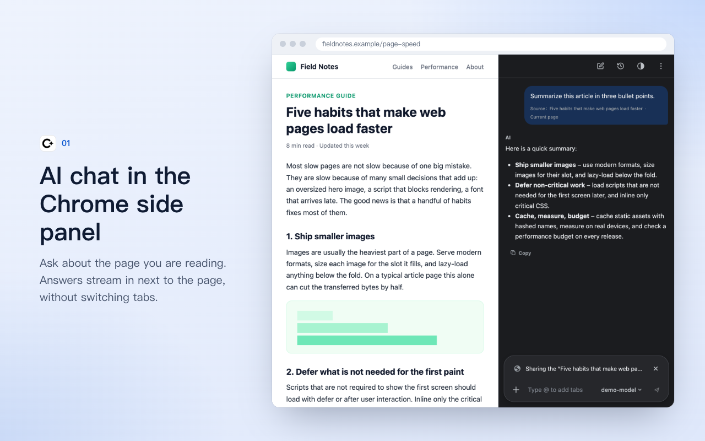
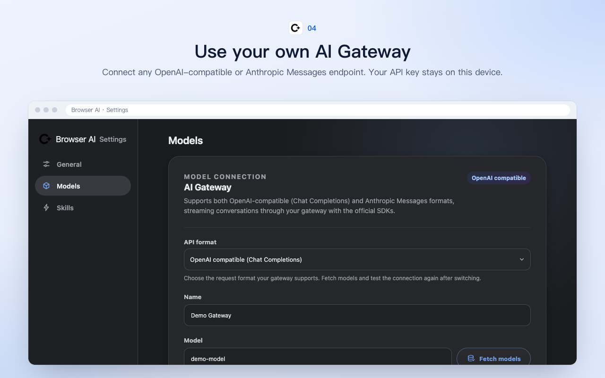

# Browser AI

[简体中文](README.md) | [繁體中文](README.zh-TW.md) | **English**

A Manifest V3 extension modeled on Chrome's "Ask Gemini" experience. It brings an AI chat into the Chrome Side Panel and, when you choose, combines it with the current page, other tabs, selected text, screenshots, and files. Answers are streamed through a Gateway that speaks either the OpenAI-compatible or the Anthropic Messages format.

The project uses React, TypeScript, WXT, and the official OpenAI and Anthropic JavaScript SDKs. API requests are sent only from the extension's Background Service Worker, so page scripts can never read your Gateway key.





## Features

### Chat

- Native side panel: click the toolbar icon to open it without covering the page. The side panel is bound to the tab it was opened in and does not follow you to other tabs.
- First-time setup: until a Gateway is configured, the side panel shows a "Connect your AI Gateway" card. Pick an API format, enter the Base URL and API Key, and click "Connect". The extension fetches the model list, picks a text model, and saves the configuration.
- Floating chat: choose "Open floating chat" from the "⋮" menu to show the chat panel in the bottom-right corner of the current page and close the side panel. The panel can be dragged, resized, minimized, and closed, and its position and size are remembered. It comes back automatically after a page reload and stays in the tab where it was opened. Opening the side panel closes the floating panel, and closing the floating panel does not reopen the side panel.
- Streaming answers: token-by-token output, stop generating, error messages, and retry.
- Model switching: click the model button on the right of the input box to search for and switch the model for the current chat. Your choice is remembered and used for new chats.
- Safe Markdown: code blocks with copy, lists, and tables, with dangerous links and HTML filtered out.
- Per-tab isolation: each tab keeps its own current chat and page context.
- Local history: pin, delete, and clear chats, with retention of 7/30/90 days or forever.

### Context

- Current page: the title, URL, and body text are extracted locally and shown above the input box as a "Sharing the … tab" card. Click the close button on the card to stop sharing the page. Once dismissed, it is not added back when a reply finishes, the page updates, or you navigate; click "Share current page" to bring it back.
- Multiple tabs: type `@`, or choose "＋" → "Add tab", to add up to 5 other tabs in the current window as context. The first time, Chrome asks once for the `tabs` permission and access to all sites.
- Selected text: text you select on the page is added to the input box as "Selected text" automatically.
- Screenshots: choose "＋" → "Select from screen", drag a region on the page, then double-click or press Enter to attach it as an image. Press Esc to cancel.
- File upload: PNG, JPEG, WebP, and GIF images, plus PDF, Word (doc/docx), Excel (xls/xlsx), TXT, Markdown, CSV, TSV, JSON, XML, HTML, and other documents. Documents are converted to text locally before sending. The default limit is 5 MB per file and can be set between 1 and 20 MB in Settings.
- Context length: the maximum number of page characters sent can be set between 5,000 and 200,000 in Settings.

### Tools

- Quick actions: the bottom-left of a new chat shows Summarize, Explain, Translate, and Analyze tech stack by default. In Settings → "General" → "Shortcuts" you can replace them with up to 4 skills from "Your skills", or restore the defaults. Once a chat has messages, the same buttons are available from "＋" → "Shortcuts", where "Manage shortcuts" opens Settings.
- Skills: type `/` to pick a skill; its instructions are sent along with your message. You can create your own skills, and while editing a skill's instructions you can undo, redo, or click "Improve with AI". "Browsing skills" in Settings includes the 49 skills from Chrome's "Ask Gemini" (Writing, Entertainment, Learning, Understanding, Research, Shopping), using Chrome's original wording in both Chinese and English, plus 4 skills of this extension's own: Summarize, Explain, Translate, and Analyze tech stack. Any of them can be added to "Your skills" with one click.
- Act on page: turn on "Act on page" from "＋" and the AI can click, type, or select elements on the current page for that one message; it turns off automatically after sending. The AI will not enter passwords, upload files, make payments, delete data, or publish content; you need to do those yourself.
- AI writing assistant: when you type in a multi-line text box on a web page, a writing assistant icon appears in its bottom-right corner. Pick a tone (Polish, Professional, Friendly, Concise) and a model (searchable) from the two drop-downs side by side, add context, and polish your text, then insert it back into the text box with one click. Text is sent only when you click "Polish writing", and the icon can be turned off in Settings. On sites the extension already has access to, the icon comes back by itself after a page refresh or an extension reload, without opening the side panel first.
- Writing assistant in the composer: in the side panel, choose "＋" → "AI Writing Assistant" to polish your current draft with a chosen tone and model. Copy the result, or click "Use in chat" to replace the draft; nothing is sent automatically.

### Settings and appearance

- Settings page: "⋮" → "Settings" opens Settings in a new tab, with three sections: "General", "Models", and "Skills".
- Display language: Follow browser, 简体中文, 繁體中文, or English, under Settings → "General" → "Display language".
- Appearance: Follow browser, Light, or Dark. Switch it with the appearance button next to "History" at the top of the side panel, or under Settings → "General" → "Appearance".
- Accent color: 21 accent colors to choose from.
- Least privilege: `activeTab` by default. Automatic access to all sites is an optional grant, with site exclusions and "Allow once".
- Gateway configuration: both OpenAI-compatible and Anthropic Messages formats, with Base URL, model fetch/select/manual entry, API Key, custom headers, timeout, Temperature, and max output tokens.

## Installation

Requires Chrome 114+ and Node.js 20.19+.

```bash
npm ci
npm run build
```

Then in Chrome:

1. Open `chrome://extensions`.
2. Turn on "Developer mode" in the top-right corner.
3. Click "Load unpacked".
4. Select the project's `.output/chrome-mv3` directory.
5. Pin the **Browser AI** icon and click it to open the side panel.

To build a zip for distribution:

```bash
npm run zip
```

## Configuring a Gateway

For a first-time setup you can simply use the "Connect" card in the side panel. For more options, open the extension's Settings, go to "Models", and fill in:

- **API format**: "OpenAI compatible" or "Anthropic Messages".
- **Name**: for example "Team Gateway".
- **Base URL**: new configurations default to `https://api.openai.com/v1` (the name is empty by default and must be filled in before saving). You can change it to any other OpenAI-compatible Gateway.
- **Model**: click "Fetch models" to load models from the Gateway's `/models` endpoint and pick one from a searchable list, or type a model ID by hand.
- **API Key**: stored only in local extension storage and never shown back in plain text.
- **Custom headers**: optional JSON. Protected headers such as `Authorization`, `Content-Type`, `Host`, and `Origin` cannot be overridden.

When you click "Fetch models", "Test gateway", or "Save configuration", Chrome requests network access only for the exact origin of the current Gateway. "Test gateway" sends a minimal streaming request with the current draft configuration and does not save it. Switching to another Gateway origin requires granting access again.

### OpenAI-compatible format

The adapter uses `models.list()` and `chat.completions.create()` from the official OpenAI SDK. The Gateway must support:

```text
POST {baseURL}/chat/completions
Authorization: Bearer <api-key>
stream: true
choices[].delta.content
```

The final streaming chunk should include `finish_reason`. To report token usage, return a usage chunk.

### Anthropic Messages format

The adapter uses the official Anthropic SDK and sends requests to `{baseURL}/v1/messages`. The Base URL defaults to `https://api.anthropic.com`. If the Base URL you enter already ends with `/v1`, it is removed automatically so the path never becomes `/v1/v1`.

- The API Key is sent in `x-api-key`, and custom headers cannot override it.
- If "Max output tokens" is empty, 8192 is sent. A Temperature above 1 is sent as 1.

## Permissions and privacy

- The extension has no static `<all_urls>` content script.
- By default, the current tab is read through `activeTab` only after you click the extension.
- Page text and selections stay in memory until you send a message and are not written to chat history.
- The API Key is stored in the trusted context of `chrome.storage.local`. Content scripts have no message interface for reading it.
- Gateway requests are sent by the Background and only to origins you have explicitly granted.
- Automatic access to all sites requires separately granting the optional `http://*/*` and `https://*/*` permissions. Turning it off unregisters the dynamic content script. After the extension is reloaded or updated, the page script is restored on sites it already has access to, without asking for new permissions; other sites still need one click on the extension icon or opening the side panel.
- Sharing other tabs with `@` requires the optional `tabs` permission, requested together with access to all sites the first time. The `favicon` permission is used only to show those tabs' site icons.
- Uploaded documents are parsed into text locally and screenshots are cropped locally. Both are uploaded only when you send a message.
- Floating chat needs access to the current site and asks for it the first time. To embed it in the page, `floating.html` is declared in `web_accessible_resources`. It only shows content in the tab where you opened floating chat; embedded by any other page it is blank, and page scripts cannot read its contents.

Asking a question with page context means the relevant page text is uploaded to the Gateway you configured. When using a third-party Gateway, also follow that service's data handling policy.

## Development

```bash
npm run dev        # Start WXT dev mode
npm run typecheck  # TypeScript check
npm run lint       # ESLint
npm test           # Vitest unit and integration tests
npm run build      # Production build
npm run check      # Full quality check
```

Main directories:

```text
entrypoints/       Chrome Background, Content, Options, and Side Panel entry points
components/        Chat, composer, context, history, and settings components
core/              Chat orchestration, page extraction, permissions, providers, and streaming state
messaging/         Runtime message and long-lived connection protocols
storage/           Configuration, conversations, tab bindings, and retention policy
shared/            Types, errors, constants, i18n, and redaction rules
tests/             Unit tests, integration tests, fixtures, and Chrome mocks
```

## Current limitations

Only **streaming** OpenAI-compatible Chat Completions and Anthropic Messages are supported. The Responses API, non-streaming Gateways, native model tool calling (function calling), and voice are not supported yet. Image attachments require a model that accepts image input; document attachments are converted to text first and do not depend on the model's file support. Chrome internal pages, the Chrome Web Store, and other restricted pages cannot be read, but you can still chat there without page context.

Before releasing, follow the [manual smoke test](docs/manual-smoke-test.md) (in Chinese) to verify real Chrome permission prompts, the Side Panel, Service Worker restarts, and page selections. For common configuration, CORS, model, and streaming protocol issues, see [Troubleshooting](docs/troubleshooting.md) (in Chinese).

## License

[MIT](LICENSE) © JIRI
