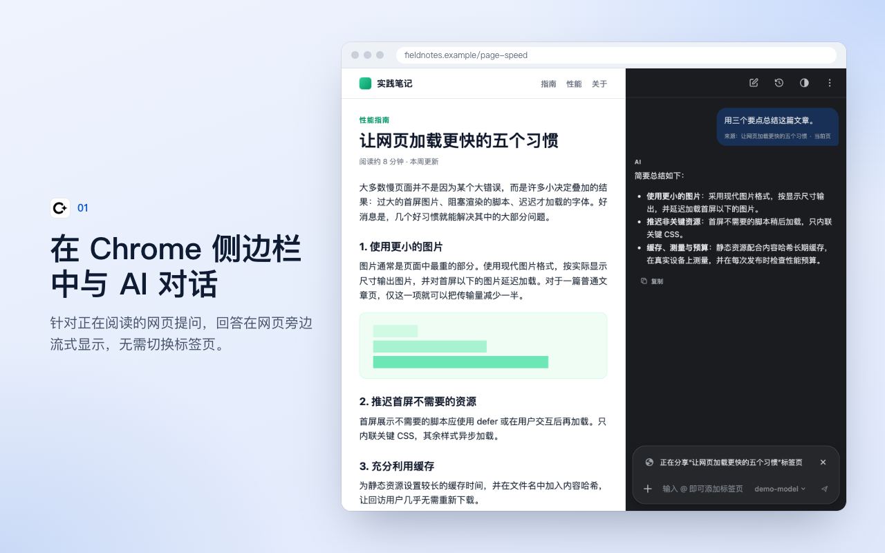
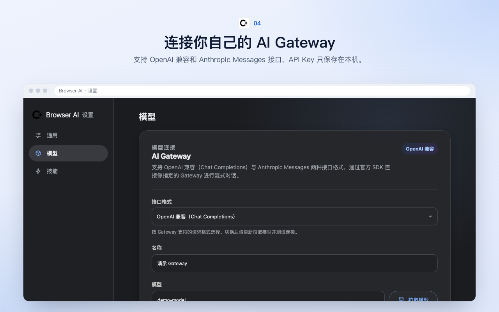

# Browser AI

**简体中文** | [繁體中文](README.zh-TW.md) | [English](README.en.md)

一个参考 Chrome「问问 Gemini」交互方式实现的 Manifest V3 扩展。它在 Chrome Side Panel 中提供 AI 对话，并可按需结合当前页面、其他标签页、选中文本、截图和文件，通过 OpenAI-compatible 或 Anthropic Messages 格式的 Gateway 流式生成回答。

项目使用 React、TypeScript、WXT，以及 OpenAI 和 Anthropic 的官方 JavaScript SDK。API 请求只从扩展 Background Service Worker 发出，页面脚本无法读取 Gateway 密钥。





## 功能

### 对话

- 原生侧边栏体验：点击工具栏图标即可打开，不遮挡当前网页。侧边栏只绑定在打开它的标签页上，切到其他标签页时不会自动出现。
- 首次连接：还没配置 Gateway 时，侧边栏顶部会显示“连接 AI Gateway”卡片。选好接口格式，填写 Base URL 和 API Key 后点“一键连接”，会自动拉取模型、选好一个文本模型并保存。
- 浮动聊天：在“⋮”菜单中选择“浮动显示”，聊天面板会显示在当前网页右下角，同时关闭侧边栏。面板可以拖动、调整大小、最小化和关闭，位置和大小会记住。刷新页面后面板会自动重新出现；它只留在打开它的标签页里。打开侧边栏时会自动关闭面板，关闭面板也不会重新打开侧边栏。
- 流式回答：支持逐字输出、停止生成、失败提示和重试。
- 模型切换：点输入框右侧的模型按钮，可以搜索并切换当前对话使用的模型。切换后会记住这个选择，之后的新会话默认使用它。
- 安全 Markdown：支持代码块、复制、列表和表格，过滤危险链接与 HTML。
- 标签页隔离：每个标签页维护独立的当前对话和页面上下文。
- 本地历史：支持固定、删除、清理以及 7/30/90 天或永久保留策略。

### 上下文

- 当前页：本地提取标题、URL 和正文，以“正在分享……标签页”卡片显示在输入框上方。点击卡片右侧的关闭按钮即可不分享当前页；关闭后，回复完成、页面更新或跳转都不会自动加回来，需要时点“分享当前页”手动恢复。
- 多个标签页：输入 `@`，或点“＋”→“添加标签页”，可以把当前窗口的其他标签页一起作为上下文，最多 5 个。首次使用时 Chrome 会申请一次 `tabs` 和全部网站访问权限。
- 选中文本：在网页上选中文字后，会自动作为“选中文本”加入输入框。
- 截图：“＋”→“从屏幕上选择”，在网页上框选区域，双击或按 Enter 确认后作为图片附件，Esc 取消。
- 上传文件：支持 PNG、JPEG、WebP、GIF 图片，以及 PDF、Word（doc/docx）、Excel（xls/xlsx）、TXT、Markdown、CSV、TSV、JSON、XML、HTML 等文档。文档在本地转成文本后发送，单个文件默认上限 5 MB，可以在设置中调整为 1～20 MB。
- 上下文长度：可以在设置中调整页面正文的最大发送字数，范围是 5,000～200,000 字。

### 工具

- 快捷操作：新会话页左下角默认显示总结、解释、翻译和分析技术栈。可以在设置 →“通用”→“快捷方式”中换成“您的技能”里的技能，最多 4 个，也可以恢复默认。
- 技能：输入 `/` 选择技能，技能的指令会和你的消息一起发送。你可以自建技能，在编辑技能指令时还能撤销、重做，或者点“使用 AI 改进”优化指令。设置页的“浏览技能”内置了 Chrome「问问 Gemini」的 49 个技能（写作、娱乐、学习、理解、研究、购物），中文和英文都使用 Chrome 原版文案；另外还有“总结”“解释”“翻译”“分析技术栈”4 个本插件自带的技能。都可以一键添加到“您的技能”。
- 操作网页：在“＋”中开启“操作网页”后，AI 可以在这一条消息里点击、输入或选择当前网页上的元素，发送后自动关闭。AI 不会输入密码、上传文件、付款、删除数据或发布内容，这些操作需要你自己完成。
- AI 写作助手：在网页的多行文本框中输入时，右下角会出现写作助手图标。选择语气、补充语境后可以润色文字，然后一键插入回文本框。只有点“开始润色”时才会发送文字，也可以在设置中关闭自动显示。

### 设置与外观

- 设置页：点“⋮”→“设置”会在新标签页打开设置，分为“通用”“模型”“技能”三栏。
- 显示语言：支持跟随浏览器、简体中文、繁體中文和 English，在设置 →“通用”→“显示语言”中切换。
- 外观：支持跟随浏览器、浅色和深色。可以点侧边栏顶部“历史记录”旁边的外观按钮切换，也可以在设置 →“通用”→“外观”中修改。
- 主题颜色：提供 21 种强调色。
- 最小权限：默认使用 `activeTab`；全站自动访问为可选授权，并支持排除网站和“仅本次允许”。
- Gateway 配置：支持 OpenAI 兼容和 Anthropic Messages 两种接口格式，可以配置 Base URL、模型拉取/选择/手动输入、API Key、自定义 Header、超时、Temperature 和最大输出 Tokens。

## 安装

要求 Chrome 114+、Node.js 20.19+。

```bash
npm ci
npm run build
```

然后在 Chrome 中：

1. 打开 `chrome://extensions`。
2. 开启右上角“开发者模式”。
3. 点击“加载已解压的扩展程序”。
4. 选择项目下的 `.output/chrome-mv3` 目录。
5. 固定 **Browser AI** 图标并点击打开侧边栏。

用于分发的 zip 可通过以下命令生成：

```bash
npm run zip
```

## 配置 Gateway

首次使用时可以直接用侧边栏里的“一键连接”卡片。需要更多选项时，打开扩展设置，进入“模型”，填写：

- **接口格式**：“OpenAI 兼容”或“Anthropic Messages”。
- **名称**：例如“团队 Gateway”。
- **Base URL**：新配置默认使用 `https://api.openai.com/v1`（名称默认留空，保存前需填写），也可以修改为其他 OpenAI-compatible Gateway。
- **模型**：可点击“拉取模型”从 Gateway 的 `/models` 接口加载模型，在可搜索的列表中选择，也可以直接手动输入模型 ID。
- **API Key**：只保存在本机扩展存储中，不会回填明文。
- **自定义请求头**：可选 JSON；不能覆盖 `Authorization`、`Content-Type`、`Host`、`Origin` 等受保护 Header。

点击“拉取模型”“测试网关”或“保存配置”时，Chrome 只会请求当前 Gateway 精确 origin 的网络权限。测试网关会使用当前草稿配置发起最小流式请求，不会隐式保存；切换到另一个 Gateway origin 时需要重新授权。

### OpenAI 兼容格式

适配器使用 OpenAI 官方 SDK 的 `models.list()` 和 `chat.completions.create()`，Gateway 需要支持：

```text
POST {baseURL}/chat/completions
Authorization: Bearer <api-key>
stream: true
choices[].delta.content
```

最终流式 chunk 应包含 `finish_reason`；如需统计 Tokens，可返回 usage chunk。

### Anthropic Messages 格式

适配器使用 Anthropic 官方 SDK，请求发往 `{baseURL}/v1/messages`，Base URL 默认为 `https://api.anthropic.com`。如果填写的 Base URL 末尾已经有 `/v1`，会自动去掉，不会变成 `/v1/v1`。

- API Key 通过 `x-api-key` 发送，自定义请求头不能覆盖它。
- 不填“最大输出 Tokens”时按 8192 发送；Temperature 超过 1 时按 1 发送。

## 权限与隐私

- 扩展没有静态 `<all_urls>` Content Script。
- 默认只在用户点击扩展后，通过 `activeTab` 读取当前标签页。
- 页面正文和选区在用户发送消息前只存在于内存中，不写入对话历史。
- API Key 保存在 `chrome.storage.local` 的 trusted context，Content Script 没有读取密钥的消息接口。
- Gateway 请求由 Background 发出，且只允许用户明确授权的 origin。
- “所有网站自动可用”需要单独授予 `http://*/*` 和 `https://*/*` 可选权限，关闭后会注销动态 Content Script。
- 用 `@` 分享其他标签页需要可选的 `tabs` 权限，首次使用时和全部网站访问权限一起申请。`favicon` 权限只用来显示这些标签页的网站图标。
- 上传的文档在本地解析成文本，截图在本地裁剪，都只在发送消息时上传。
- 浮动聊天需要当前网站的访问权限，首次使用时会申请。为了放进网页，`floating.html` 声明为 `web_accessible_resources`；它只在用户打开浮动聊天的标签页里显示内容，被其他网页嵌入时是空白页面，页面脚本也读不到里面的内容。

发送带页面上下文的问题意味着相关正文片段会上传到你配置的 Gateway。使用第三方 Gateway 时，应同时遵守该服务的数据处理政策。

## 开发

```bash
npm run dev        # 启动 WXT 开发模式
npm run typecheck  # TypeScript 检查
npm run lint       # ESLint
npm test           # Vitest 单元与集成测试
npm run build      # 生产构建
npm run check      # 执行完整质量检查
```

主要目录：

```text
entrypoints/       Chrome Background、Content、Options 和 Side Panel 入口
components/        对话、输入框、上下文、历史和设置组件
core/              聊天编排、页面提取、权限、Provider 与流式状态
messaging/         Runtime Message 与长连接协议
storage/           配置、对话、标签页绑定和保留策略
shared/            类型、错误、常量、国际化和脱敏规则
tests/             单元测试、集成测试、Fixture 与 Chrome Mock
```

## 当前边界

目前只支持**流式**的 OpenAI-compatible Chat Completions 和 Anthropic Messages。暂不支持 Responses API、非流式 Gateway、模型原生的工具调用（function calling）和语音。图片附件需要所选模型支持图片输入；文档附件会先转成文本，不依赖模型的文件能力。Chrome 内部页面、Chrome Web Store 及其他受限页面无法读取正文，但仍可进行不带页面上下文的普通对话。

发布前请按 [手工冒烟测试](docs/manual-smoke-test.md) 验证真实 Chrome 权限弹窗、Side Panel、Service Worker 重启和页面选区。常见配置、CORS、模型及流式协议问题见 [故障排查](docs/troubleshooting.md)。

## 许可证

[MIT](LICENSE) © JIRI
