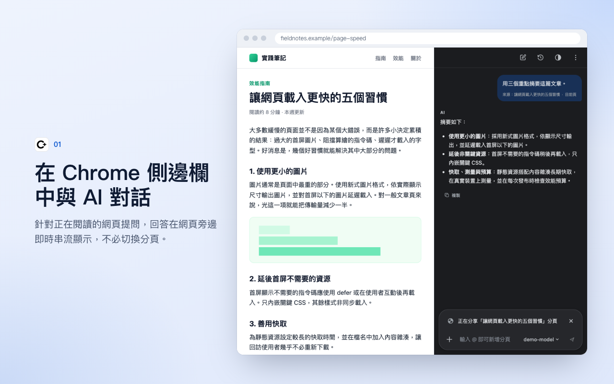
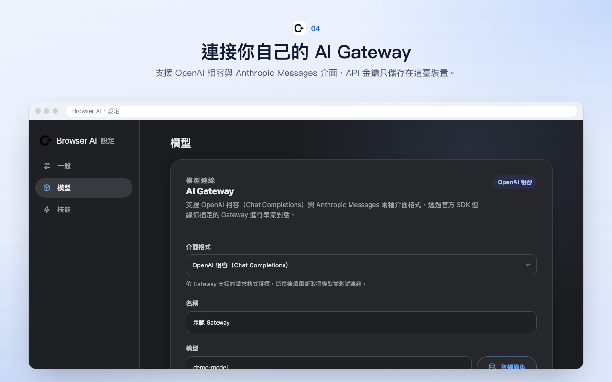

# Browser AI

[简体中文](README.md) | **繁體中文** | [English](README.en.md)

一個參考 Chrome「問問 Gemini」互動方式實作的 Manifest V3 擴充功能。它在 Chrome 側邊欄中提供 AI 對話，並可視需要結合目前頁面、其他分頁、選取文字、截圖和檔案，透過 OpenAI 相容或 Anthropic Messages 格式的 Gateway 串流產生回答。

專案使用 React、TypeScript、WXT，以及 OpenAI 和 Anthropic 的官方 JavaScript SDK。API 請求只從擴充功能的 Background Service Worker 發出，頁面指令碼無法讀取 Gateway 金鑰。





## 功能

### 對話

- 原生側邊欄體驗：點擊工具列圖示即可開啟，不會遮住目前網頁。側邊欄只綁定在開啟它的分頁上，切換到其他分頁時不會自動出現。
- 首次連接：還沒設定 Gateway 時，側邊欄頂端會顯示「連接 AI Gateway」卡片。選好介面格式，填寫 Base URL 和 API Key 後點「一鍵連接」，會自動取得模型、選好一個文字模型並儲存。
- 浮動聊天：在「⋮」選單中選擇「浮動顯示」，聊天面板會顯示在目前網頁右下角，同時關閉側邊欄。面板可以拖曳、調整大小、最小化和關閉，位置和大小會記住。重新整理頁面後面板會自動重新出現；它只留在開啟它的分頁裡。開啟側邊欄時會自動關閉面板，關閉面板也不會重新開啟側邊欄。
- 串流回答：支援逐字輸出、停止產生、錯誤提示和重試。
- 模型切換：點輸入框右側的模型按鈕，可以搜尋並切換目前對話使用的模型。切換後會記住這個選擇，之後的新對話預設使用它。
- 安全 Markdown：支援程式碼區塊、複製、清單和表格，並過濾危險連結與 HTML。
- 分頁隔離：每個分頁維護獨立的目前對話和頁面上下文。
- 本機歷史紀錄：支援釘選、刪除、清除，以及 7/30/90 天或永久保留。

### 上下文

- 目前頁面：在本機擷取標題、URL 和內文，以「正在分享……分頁」卡片顯示在輸入框上方。點卡片右側的關閉按鈕即可不分享目前頁面；關閉後，回覆完成、頁面更新或跳轉都不會自動加回來，需要時點「分享目前頁面」手動恢復。
- 多個分頁：輸入 `@`，或點「＋」→「新增分頁」，可以把目前視窗的其他分頁一起作為上下文，最多 5 個。第一次使用時 Chrome 會要求一次 `tabs` 和所有網站的存取權限。
- 選取文字：在網頁上選取文字後，會自動以「選取文字」加入輸入框。
- 截圖：「＋」→「從螢幕上選取」，在網頁上框選區域，雙擊或按 Enter 確認後作為圖片附件，按 Esc 取消。
- 上傳檔案：支援 PNG、JPEG、WebP、GIF 圖片，以及 PDF、Word（doc/docx）、Excel（xls/xlsx）、TXT、Markdown、CSV、TSV、JSON、XML、HTML 等文件。文件會在本機轉成文字後傳送，單一檔案預設上限 5 MB，可以在設定中調整為 1～20 MB。
- 上下文長度：可以在設定中調整頁面內文的最大傳送字數，範圍是 5,000～200,000 字。

### 工具

- 快捷操作：新對話頁左下角預設顯示總結、解釋、翻譯和分析技術棧。可以在設定 →「一般」→「捷徑」中換成「您的技能」裡的技能，最多 4 個，也可以恢復預設。對話中已有訊息時，也可以點「＋」→「捷徑」使用同樣的按鈕，子選單裡的「管理捷徑」會開啟設定。
- 技能：輸入 `/` 選擇技能，技能的指令會和你的訊息一起傳送。你可以自建技能，在編輯技能指令時還能復原、重做，或者點「使用 AI 改進」最佳化指令。設定頁的「瀏覽技能」內建了 Chrome「問問 Gemini」的 49 個技能（寫作、娛樂、學習、理解、研究、購物），中文和英文都使用 Chrome 原版文案；另外還有「總結」「解釋」「翻譯」「分析技術棧」4 個本擴充功能自帶的技能。都可以一鍵加入「您的技能」。
- 操作網頁：在「＋」中開啟「操作網頁」後，AI 可以在這一則訊息裡點擊、輸入或選擇目前網頁上的元素，傳送後自動關閉。AI 不會輸入密碼、上傳檔案、付款、刪除資料或發布內容，這些操作需要你自己完成。
- AI 寫作助理：在網頁的多行文字框中輸入時，右下角會出現寫作助理圖示。在同一列的兩個下拉選單中選擇語氣（自然潤飾、專業、友善、簡潔）和模型（可搜尋），補充情境後潤飾文字，再一鍵插入回文字框。只有點「開始潤飾」時才會傳送文字，也可以在設定中關閉自動顯示。已授權的網站在重新整理頁面或重新載入擴充功能後，圖示會自動恢復，不用先開啟側邊欄。
- 輸入框寫作助理：在側邊欄點「＋」→「AI 寫作助理」，會把目前草稿帶入對話框，選好語氣和模型後潤飾。結果可以複製，也可以點「填入輸入框」取代草稿，不會自動傳送。

### 設定與外觀

- 設定頁：點「⋮」→「設定」會在新分頁開啟設定，分為「一般」「模型」「技能」三欄。
- 顯示語言：支援跟隨瀏覽器、简体中文、繁體中文和 English，在設定 →「一般」→「顯示語言」中切換。
- 外觀：支援跟隨瀏覽器、淺色和深色。可以點側邊欄頂端「歷史紀錄」旁邊的外觀按鈕切換，也可以在設定 →「一般」→「外觀」中修改。
- 主題顏色：提供 21 種強調色。
- 最小權限：預設使用 `activeTab`；所有網站自動存取為選擇性授權，並支援排除網站和「允許本次讀取」。
- Gateway 設定：支援 OpenAI 相容和 Anthropic Messages 兩種介面格式，可以設定 Base URL、模型取得/選擇/手動輸入、API Key、自訂請求標頭、逾時、Temperature 和最大輸出 Tokens。

## 安裝

需要較新版本的 Chrome 與 Node.js。

```bash
npm ci
npm run build
```

接著在 Chrome 中：

1. 開啟 `chrome://extensions`。
2. 開啟右上角的「開發人員模式」。
3. 點擊「載入未封裝項目」。
4. 選擇專案下的 `.output/chrome-mv3` 目錄。
5. 釘選 **Browser AI** 圖示並點擊開啟側邊欄。

用於發布的 zip 可透過以下指令產生：

```bash
npm run zip
```

## 設定 Gateway

第一次使用時可以直接用側邊欄裡的「一鍵連接」卡片。需要更多選項時，開啟擴充功能設定，進入「模型」，填寫：

- **介面格式**：「OpenAI 相容」或「Anthropic Messages」。
- **名稱**：例如「團隊 Gateway」。
- **Base URL**：新設定預設使用 `https://api.openai.com/v1`（名稱預設留空，儲存前需填寫），也可以改成其他 OpenAI 相容的 Gateway。只填網域（如 `https://gw.example.com/`）時會自動補上 `/v1`，填 `https://gw.example.com/v1` 也一樣可用；帶其他路徑的網址保持原樣。
- **模型**：可點「取得模型」從 Gateway 的 `/models` 介面載入模型，在可搜尋的清單中選擇，也可以直接手動輸入模型 ID。
- **API Key**：只儲存在本機擴充功能儲存空間中，不會以明文回填。
- **自訂請求標頭**：選填 JSON；不能覆寫 `Authorization`、`Content-Type`、`Host`、`Origin` 等受保護的標頭。

點擊「取得模型」「測試閘道」或「儲存設定」時，Chrome 只會要求目前 Gateway 精確 origin 的網路權限。測試閘道會用目前的草稿設定發出最小串流請求，不會自動儲存；切換到另一個 Gateway origin 時需要重新授權。

### OpenAI 相容格式

轉接器使用 OpenAI 官方 SDK 的 `models.list()` 和 `chat.completions.create()`，Gateway 需要支援：

```text
POST {baseURL}/chat/completions
Authorization: Bearer <api-key>
stream: true
choices[].delta.content
```

最後一個串流 chunk 應包含 `finish_reason`；如需統計 Tokens，可回傳 usage chunk。

### Anthropic Messages 格式

轉接器使用 Anthropic 官方 SDK，請求發往 `{baseURL}/v1/messages`，Base URL 預設為 `https://api.anthropic.com`。如果填寫的 Base URL 結尾已經有 `/v1`，會自動去掉，不會變成 `/v1/v1`。

- API Key 透過 `x-api-key` 傳送，自訂請求標頭不能覆寫它。
- 未填「最大輸出 Tokens」時以 8192 傳送；Temperature 超過 1 時以 1 傳送。

## 權限與隱私

- 擴充功能沒有靜態的 `<all_urls>` Content Script。
- 預設只在使用者點擊擴充功能後，透過 `activeTab` 讀取目前分頁。
- 頁面內文和選取內容在使用者傳送訊息前只存在記憶體中，不會寫入對話紀錄。
- API Key 儲存在 `chrome.storage.local` 的 trusted context，Content Script 沒有讀取金鑰的訊息介面。
- Gateway 請求由 Background 發出，且只允許使用者明確授權的 origin。
- 所有網站自動存取需要另外授予 `http://*/*` 和 `https://*/*` 選擇性權限，關閉後會取消註冊動態 Content Script。擴充功能重新載入或更新後，會為已授權的網站自動恢復頁面指令碼，不會跳出新的權限要求；沒有授權的網站仍需點一次擴充功能圖示或開啟側邊欄。
- 用 `@` 分享其他分頁需要選擇性的 `tabs` 權限，第一次使用時會和所有網站存取權限一起要求。`favicon` 權限只用來顯示這些分頁的網站圖示。
- 上傳的文件在本機解析成文字，截圖在本機裁切，都只在傳送訊息時上傳。
- 浮動聊天需要目前網站的存取權限，第一次使用時會要求。為了放進網頁，`floating.html` 宣告為 `web_accessible_resources`；它只在使用者開啟浮動聊天的分頁裡顯示內容，被其他網頁嵌入時是空白頁面，頁面指令碼也讀不到裡面的內容。

傳送帶有頁面上下文的問題，代表相關內文片段會上傳到你設定的 Gateway。使用第三方 Gateway 時，也應遵守該服務的資料處理政策。

## 開發

```bash
npm run dev        # 啟動 WXT 開發模式
npm run typecheck  # TypeScript 檢查
npm run lint       # ESLint
npm test           # Vitest 單元與整合測試
npm run build      # 正式建置
npm run check      # 執行完整品質檢查
```

主要目錄：

```text
entrypoints/       Chrome Background、Content、Options 和 Side Panel 入口
components/        對話、輸入框、上下文、歷史紀錄和設定元件
core/              聊天編排、頁面擷取、權限、Provider 與串流狀態
messaging/         Runtime Message 與長連線協定
storage/           設定、對話、分頁綁定和保留政策
shared/            型別、錯誤、常數、國際化和去識別化規則
tests/             單元測試、整合測試、Fixture 與 Chrome Mock
```

## 目前限制

目前只支援**串流**的 OpenAI 相容 Chat Completions 和 Anthropic Messages。暫不支援 Responses API、非串流 Gateway、模型原生的工具呼叫（function calling）和語音。圖片附件需要所選模型支援圖片輸入；文件附件會先轉成文字，不依賴模型的檔案能力。Chrome 內部頁面、Chrome 線上應用程式商店及其他受限頁面無法讀取內文，但仍可進行不帶頁面上下文的一般對話。

發布前請依照[手動冒煙測試](docs/manual-smoke-test.md)（簡體中文）驗證真實的 Chrome 權限對話框、側邊欄、Service Worker 重新啟動和頁面選取。常見的設定、CORS、模型及串流協定問題請見[疑難排解](docs/troubleshooting.md)（簡體中文）。

## 授權條款

[MIT](LICENSE) © JIRI
